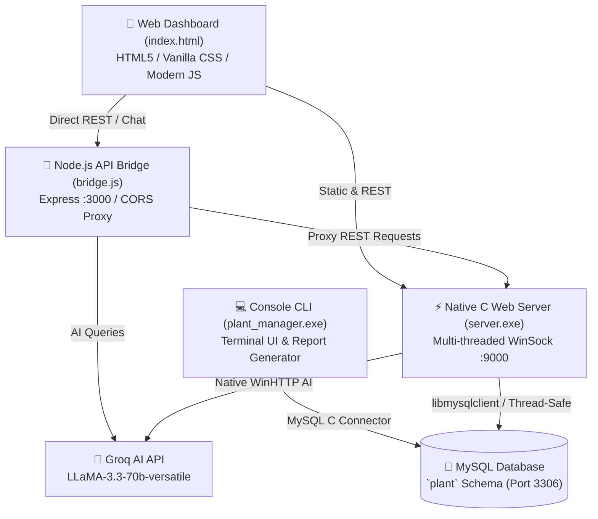

# 🌿 Smart Plant Manager (v2.0)

[](#technology-stack)
[](#architecture)
[](#database-setup)
[](#-ai-plant-care-assistant)
[](LICENSE)

> **A high-performance, hybrid botanical care management ecosystem featuring a native multi-threaded C web server, interactive Terminal CLI, Node.js API bridge, Groq LLaMA 3.3 AI plant assistant, and a modern glassmorphic web dashboard.**

---

## 🌟 What Makes Smart Plant Manager Unique?

Most plant care apps are standard CRUD apps built entirely in high-level scripting languages. **Smart Plant Manager** takes a radically unique, systems-engineering approach:

* ⚡ **High-Performance Multi-Threaded C Web Server**: Written from scratch in C (`server.c`) using WinSock2, Windows thread pools (`_beginthreadex`), thread-safe mutex locking (`CRITICAL_SECTION`), and a custom function-pointer dispatch routing table.
* 🖥️ **Dual-Mode Backend (Server & CLI)**:
  * Run **`server.exe`** as a lightweight, low-overhead HTTP REST API server handling concurrent client requests.
  * Run **`plant_manager.exe`** for an interactive, ANSI-styled console interface for fast garden management and report generation directly from the terminal.
* 🤖 **AI-Powered Botanical Expert (Groq LLaMA 3.3)**: Integrated with Groq's ultra-fast LLaMA 3.3 70B model via direct C WinHTTP calls (`ai.c`) and the Node.js bridge (`bridge.js`), providing personalized plant diagnosis, watering schedules, and care tips.
* 🗄️ **Relational Botanical Knowledge Base**: Backed by MySQL (`setup_v2.sql`) with a pre-seeded encyclopedia of 20+ plants, full watering logs, plant health states, customizable care notes, user authentication, and activity timelines.
* 🎨 **Modern Glassmorphic Web Dashboard**: Rich responsive UI (`index.html`) featuring live watering countdown timers, health status indicators (*Alive*, *Thirsty*, *Critical*, *Dead*), bulk watering, dark/light mode toggle, and an embedded PlantBot AI chat drawer.
* 🔒 **Enterprise-Grade Security Practices**: Dedicated `.env` parser written in pure C (`env.c`), ensuring zero hardcoded credentials, automatic secret redaction, and log rotation.

---

## 🏗️ System Architecture



---

## 📁 Repository Structure

```text
├── index.html          # Modern glassmorphic Web Dashboard
├── bridge.js           # Node.js Express API Bridge & AI proxy
├── package.json        # Node.js configuration & dependencies
├── setup_v2.sql        # Complete MySQL database schema & seed data
├── studyguide.html     # Interactive architecture & C data structures reference
│
├── Makefile            # MinGW GCC build script for C binaries
├── config.h            # Central server configuration & route definitions
├── plant.h             # Core domain structures (Plant, User, GardenItem)
│
├── server.c            # Multi-threaded HTTP server implementation (WinSock2)
├── http.c / http.h     # HTTP request parser & JSON response builder
├── db.c / db.h         # Database controller & JSON API route handlers
├── ai.c / ai.h         # Native C WinHTTP client for Groq AI
├── env.c / env.h       # Pure C .env file loader & environment helper
│
├── main.c              # Terminal CLI application entry point
├── dao.c / dao.h       # Data Access Object layer for CLI MySQL operations
├── ui.c / ui.h         # Console menu rendering, colors & user prompts
│
├── .env.example        # Environment variable template (safe to commit)
├── .gitignore          # Secret files, logs, and binaries filter
└── README.md           # Project documentation
```

---

## 🚀 Getting Started

### 1. Prerequisites
Ensure you have the following installed on your machine:
* **MySQL Server 8.0+**
* **GCC / MinGW-w64** (for compiling the C backend or CLI)
* **Node.js (v18+) & npm** (for the Express bridge)
* **Groq API Key** (Free tier available at [console.groq.com](https://console.groq.com))

---

### 2. Database Setup
1. Start your local MySQL service.
2. Run the `setup_v2.sql` script to create the `plant` database and populate tables:
```bash
mysql -u root -p < setup_v2.sql
```
*(Default admin account seeded: `admin` / `admin123`)*

---

### 3. Environment Configuration
Copy `.env.example` to `.env`:
```bash
copy .env.example .env     # On Windows Command Prompt / PowerShell
# or: cp .env.example .env  # On Bash
```

Edit `.env` with your actual MySQL credentials and Groq API key:
```ini
# Database Configuration
DB_HOST=localhost
DB_USER=root
DB_PASS=your_mysql_password
DB_NAME=plant

# Groq AI Settings
GROQ_API_KEY=your_groq_api_key

# Ports
PORT=9000
BRIDGE_PORT=3000
C_SERVER=http://localhost:9000
```
> ⚠️ **Security Notice**: `.env` is listed in `.gitignore` and must never be committed to public version control.

---

### 4. Running the Application

You can run the project in either **Web Mode** or **Terminal CLI Mode**:

#### Option A: Web Mode (Recommended)

1. **Install Node.js dependencies**:
   ```bash
   npm install
   ```

2. **Compile the Native C Web Server**:
   ```bash
   mingw32-make server.exe
   ```
   *Or compile manually with GCC:*
   ```bash
   gcc server.c http.c db.c ai.c env.c -I"C:\Program Files\MySQL\MySQL Server 8.0\include" -L"C:\Program Files\MySQL\MySQL Server 8.0\lib" -lmysql -lws2_32 -lwinhttp -o server.exe
   ```

3. **Start the C Server**:
   ```bash
   .\server.exe
   ```
   *The server will start listening on `http://localhost:9000`.*

4. **Start the Node.js API Bridge (in a separate terminal)**:
   ```bash
   npm start
   ```
   *The bridge will launch on `http://localhost:3000`.*

5. **Open the Dashboard**:
   Open `http://localhost:9000` (or open `index.html` in your browser).

---

#### Option B: Terminal CLI Mode

If you prefer a lightweight, pure console interface:
1. **Compile the CLI binary**:
   ```bash
   mingw32-make plant_manager.exe
   ```
   *Or compile manually:*
   ```bash
   gcc main.c dao.c ui.c env.c -I"C:\Program Files\MySQL\MySQL Server 8.0\include" -L"C:\Program Files\MySQL\MySQL Server 8.0\lib" -lmysql -o plant_manager.exe
   ```

2. **Launch the CLI**:
   ```bash
   .\plant_manager.exe
   ```
   *Login credentials: `admin` / `password`.*
   *Features: View garden, water plants, search encyclopedia, view logs, export garden report.*

---

## 📡 REST API Reference

| Method | Endpoint | Description |
|---|---|---|
| `GET` | `/api/plants` | Retrieve all plants in the botanical catalog |
| `GET` | `/api/garden` | List user's active garden plants with live countdowns |
| `POST` | `/api/garden/add` | Add a plant species to the garden |
| `POST` | `/api/garden/water` | Water a plant and reset countdown timer |
| `POST` | `/api/garden/bulk-water` | Water all thirsty plants simultaneously |
| `POST` | `/api/garden/remove` | Remove a plant from the garden |
| `POST` | `/api/garden/fav` | Toggle favorite status |
| `POST` | `/api/chat` | Send question to Groq AI PlantBot |
| `GET` | `/api/stats` | Garden analytics (alive, thirsty, dead counts) |
| `GET` | `/api/water-history` | Audit log of past watering events |
| `POST` | `/api/auth/login` | Authenticate user |
| `POST` | `/api/auth/register` | Create a new user account |

---

## 🤖 AI Plant Care Assistant

Smart Plant Manager is integrated with **Groq LLaMA 3.3 70B Versatile**:
* Ask any question regarding plant care, soil moisture, sunlight, diseases, or pruning.
* Pre-configured botanical system prompt gives concise, practical gardening advice in under 2 sentences.
* Works via direct WinHTTP native C calls (`ai.c`) or through the Express bridge (`bridge.js`).

---

## 🛡️ License

This project is licensed under the [MIT License](LICENSE) — feel free to fork, modify, and build upon it!
